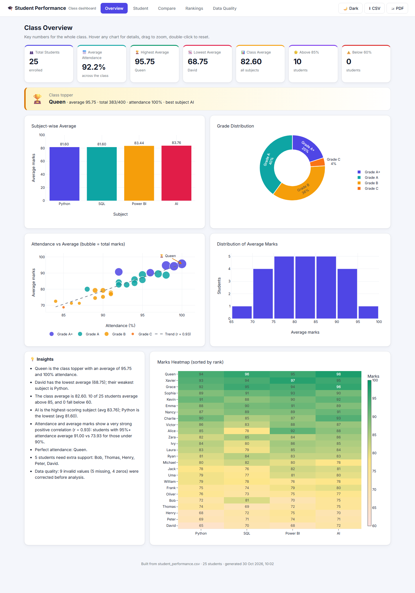
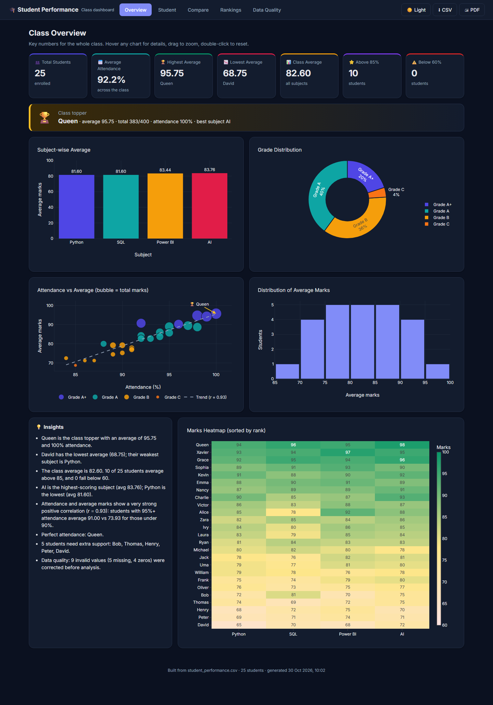
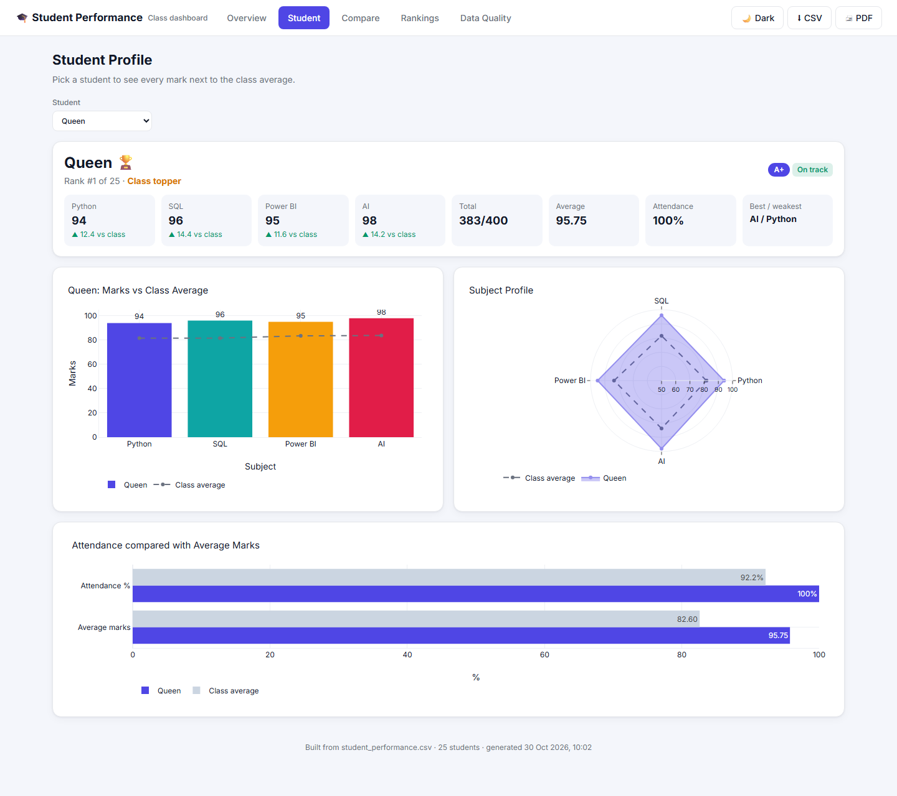
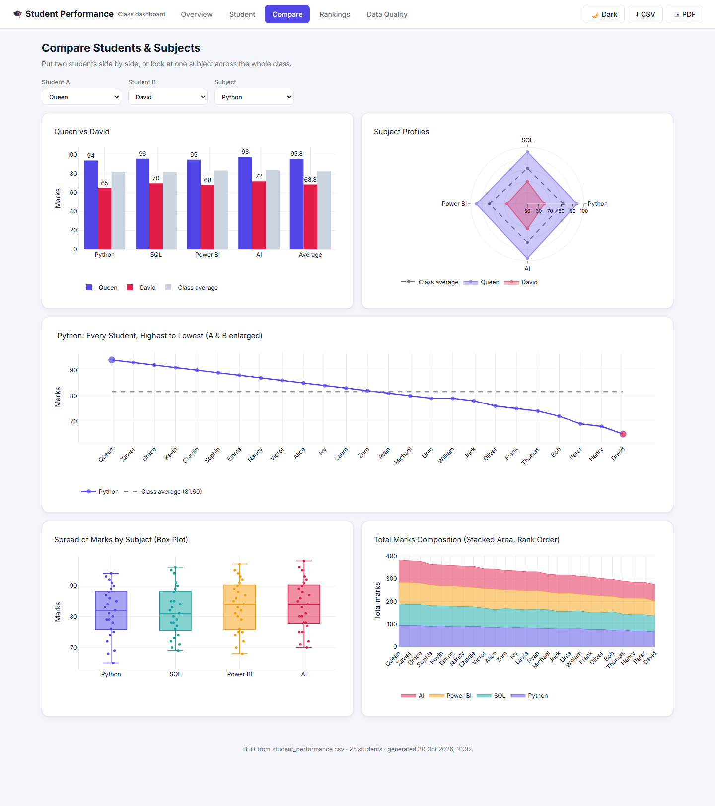
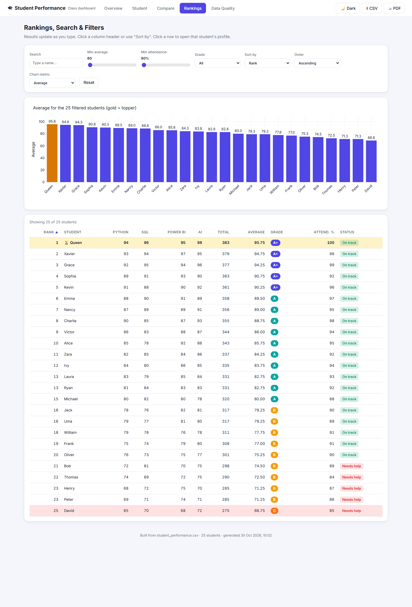
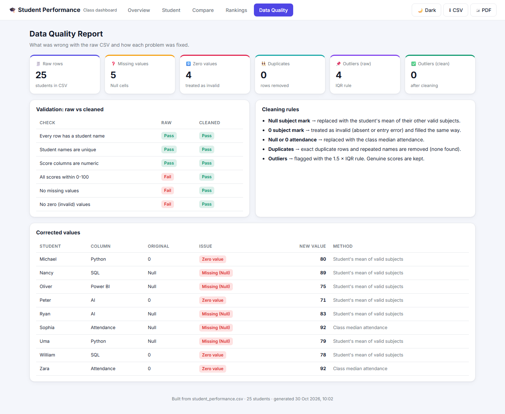
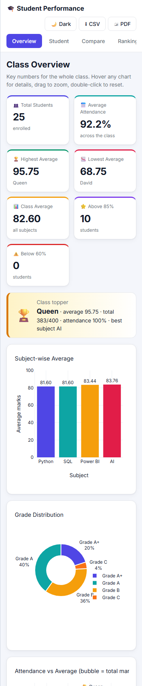

<div align="center">

# Student Performance Dashboard

**End-to-end analysis of class performance data with Python: cleaning, statistics, visual analytics and an interactive web dashboard.**

[](https://colab.research.google.com/github/Arion369/Student_Performance_Dashboard/blob/main/Mini_Project_1.ipynb)




</div>

---

## Table of Contents

- [Overview](#overview)
- [Key Features](#key-features)
- [Results at a Glance](#results-at-a-glance)
- [Tech Stack](#tech-stack)
- [Repository Structure](#repository-structure)
- [Getting Started](#getting-started)
- [Methodology](#methodology)
- [Dashboard](#dashboard)
- [Visualizations](#visualizations)
- [Screenshots](#screenshots)
- [Future Improvements](#future-improvements)
- [Author](#author)

---

## Overview

This project analyzes the marks and attendance of 25 students across four subjects: **Python, SQL, Power BI and AI**. The raw dataset contains real-world quality issues, including missing (`Null`) entries and invalid zero scores. These are detected, documented and corrected before any analysis runs.

The pipeline is implemented in a single Google Colab notebook and produces:

- A **cleaned, enriched dataset** with totals, averages, grades, ranks and performance status
- **15 exported visualizations**: static charts plus interactive Plotly charts
- **In-notebook interactive tools** built with ipywidgets
- A **standalone, five-page HTML dashboard** that runs in any browser with no server required

## Key Features

| Area | Capabilities |
|---|---|
| **Data quality** | Missing-value and zero detection, duplicate checks, IQR outlier detection, rule-based validation, and a full audit log of every correction |
| **Feature engineering** | Total, Average, Grade (A+ to F), Rank (ties share a rank), Best/Weakest Subject, Status, Imputation flag |
| **KPIs** | Total students, average attendance, highest/lowest average, class average, students above 85% and below 60% |
| **Student analysis** | Individual profiles, multi-student comparison, topper and lowest performer, rankings, multi-criteria filters |
| **Interactivity** | Student dropdown, subject selection, live search, range sliders, sorting, hover tooltips, zoom/pan, linked brushing |
| **Insights** | Top/bottom 5, subject difficulty, attendance–performance correlation, perfect attendance, students needing support |
| **Export** | Processed CSV, cleaning log, PNG/HTML charts, HTML dashboard, in-browser CSV and PDF export |

## Results at a Glance

| Metric | Value |
|---|---|
| Students analyzed | 25 |
| Class average | **82.60** |
| Average attendance | 92.2% |
| Class topper | **Queen**: 95.75 average, 100% attendance |
| Lowest average | David: 68.75 |
| Students above 85% | 10 |
| Students below 60% | 0 |

**Findings**

- **Attendance strongly predicts performance** (Pearson *r* = **0.93**). Students with 95%+ attendance average **91.0**, against **73.9** for those below 90%.
- **AI** is the highest-scoring subject (avg 83.76) and **Python** the lowest (avg 81.60).
- **Top 5:** Queen, Xavier, Grace, Sophia, Kevin.
- **Students flagged for support:** Bob, Thomas, Henry, Peter, David.

## Tech Stack

| Category | Tools |
|---|---|
| Language & environment | Python 3, Google Colab / Jupyter |
| Data processing | pandas, NumPy |
| Static visualization | Matplotlib, Seaborn |
| Interactive visualization | Plotly, Altair |
| Notebook UI | ipywidgets |
| Web dashboard | HTML5, CSS3, JavaScript, Plotly.js |

## Repository Structure

```
Student_Performance_Dashboard/
├── Mini_Project_1.ipynb                # Main notebook (complete pipeline, outputs included)
├── student_performance.csv             # Raw dataset (Null and 0 values preserved)
├── student_performance_processed.csv   # Cleaned dataset with calculated fields
├── data_cleaning_log.csv               # Audit trail of every corrected value
├── student_dashboard.html              # Standalone interactive dashboard
├── charts/                             # Exported charts (.png static, .html interactive)
├── screenshots/                        # Dashboard screenshots
├── CODE_EXPLAINED.md                   # Beginner-friendly line-by-line code walkthrough
└── README.md
```

## Getting Started

### Option 1: Google Colab (recommended)

1. Click the **Open in Colab** badge at the top of this page.
2. Select **Runtime → Run all**.
3. The final cell downloads `student_dashboard_outputs.zip`, which contains every generated artifact.

No installation or file upload is needed. If the dataset is missing, the notebook creates it.

### Option 2: Run locally

```bash
git clone https://github.com/Arion369/Student_Performance_Dashboard.git
cd Student_Performance_Dashboard
pip install pandas numpy matplotlib seaborn plotly altair ipywidgets jupyter
jupyter notebook Mini_Project_1.ipynb
```

### Option 3: View the dashboard only

Download `student_dashboard.html` and open it in any modern browser. An internet connection is needed on first load so Plotly.js can be fetched from its CDN.

## Methodology

### 1. Data cleaning

The raw data contains **5 missing values** and **4 zero scores**. Every other score is at least 65, so a zero is treated as an absence or data-entry error rather than a genuine mark.

| Issue | Treatment | Rationale |
|---|---|---|
| Missing or zero **subject mark** | Replaced with the **student's own mean** of their valid subjects | Preserves each student's individual performance level |
| Missing or zero **attendance** | Replaced with the **class median** | Robust to outliers and independent of marks |
| Duplicates | Exact duplicates and repeated names removed | None found |
| Outliers | Flagged with the **1.5 × IQR** rule | All 4 raw outliers were invalid zeros; none remain after cleaning |
| Validation | Name presence, uniqueness, numeric types, 0–100 range, nulls, zeros | 3 of 6 checks fail on the raw data; all 6 pass after cleaning |

All 9 corrections are recorded in [`data_cleaning_log.csv`](data_cleaning_log.csv), with the original value, the imputed value and the method used.

### 2. Calculated fields

| Field | Definition |
|---|---|
| Total | Sum of the four subject marks (out of 400) |
| Average | Mean of the four subject marks |
| Grade | A+ ≥ 90 · A ≥ 80 · B ≥ 70 · C ≥ 60 · D ≥ 50 · F < 50 |
| Rank | Competition ranking by Average (1, 2, 2, 4…); tied students share the higher rank |
| Status | *Needs Improvement* if the Average is < 75 or any subject is < 70; otherwise *On Track* |
| Imputed | Lists the columns corrected during cleaning |

### 3. Analysis

Descriptive statistics (mean, median, standard deviation, skew), grade distribution, subject-level summaries, correlation analysis and attendance banding.

## Dashboard

`student_dashboard.html` is a self-contained, responsive web application with five pages:

| Page | Contents |
|---|---|
| **Overview** | KPI cards, topper banner, subject averages, grade distribution, attendance vs marks with trend line, histogram, heatmap, auto-generated insights |
| **Student** | Profile card with comparison to the class average, subject bar chart, radar chart, attendance comparison |
| **Compare** | Head-to-head comparison of two students, single-subject view across the class, box plot, stacked area chart |
| **Rankings** | Searchable, filterable and sortable table with a linked bar chart; click a row to open that student's profile |
| **Data Quality** | Issue counts, validation results before and after cleaning, full correction log |

Also included: a light/dark theme, a mobile-friendly layout, CSV download, PNG export on every chart, and print-to-PDF.

## Visualizations

| # | Chart | Library | Purpose |
|---|---|---|---|
| 00 | Missing-values map | Seaborn | Locates data gaps |
| 01 | Box plots, before and after cleaning | Seaborn | Shows the impact of the outliers |
| 02 | Subject average bar chart | Matplotlib | Compares subjects |
| 03 | Average-score histogram with KDE | Seaborn | Shows the score distribution |
| 04 | Marks line chart | Matplotlib | Compares students by rank |
| 05 | Grade donut chart | Matplotlib | Shows the grade distribution |
| 06 | Subject box plot | Seaborn | Shows the spread in each subject |
| 07 | Correlation and marks heatmaps | Seaborn | Shows relationships between columns |
| 08 | Attendance vs average regression | Seaborn | Shows the attendance effect |
| 09 | Bubble chart | Plotly | Attendance, average and total in one view |
| 10 | Grouped bar chart with range slider | Plotly | Zoomable subject comparison |
| 11 | Stacked area chart | Plotly | Shows subject contributions |
| 12 | Sunburst | Plotly | Shows the grade → student hierarchy |
| 13 | Treemap | Plotly | Class composition |
| 14 | Radar chart | Plotly | Compares subject profiles |

The notebook also includes an **Altair linked-brushing** view: selecting points on the scatter plot filters the companion bar chart.

## Screenshots

| Overview | Dark mode |
|---|---|
|  |  |
| **Student profile** | **Compare** |
|  |  |
| **Rankings & filters** | **Data quality** |
|  |  |

<p align="center">
  <br>
  <em>Responsive mobile layout</em>
</p>

## Future Improvements

- Host the dashboard on GitHub Pages for one-click access
- Support uploading any class dataset with the same schema
- Add predictive modelling to flag at-risk students early
- Track performance across multiple terms

## Author

**Arjun PM**: [GitHub @Arion369](https://github.com/Arion369)

Built as Mini Project 1 for the AI Engineering course.

---

<div align="center">
<sub>If you found this project useful, consider giving it a ⭐</sub>
</div>
